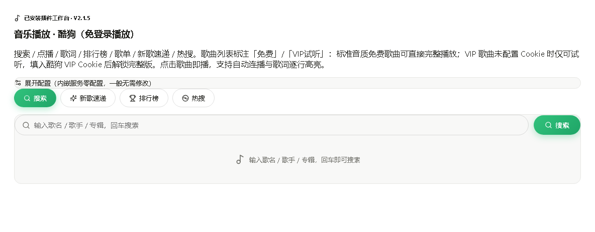
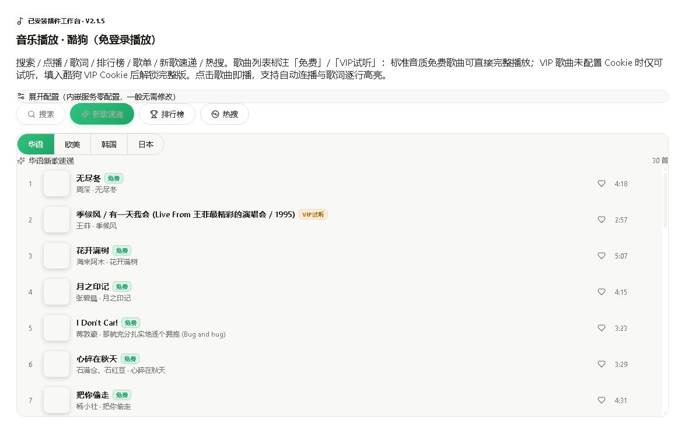
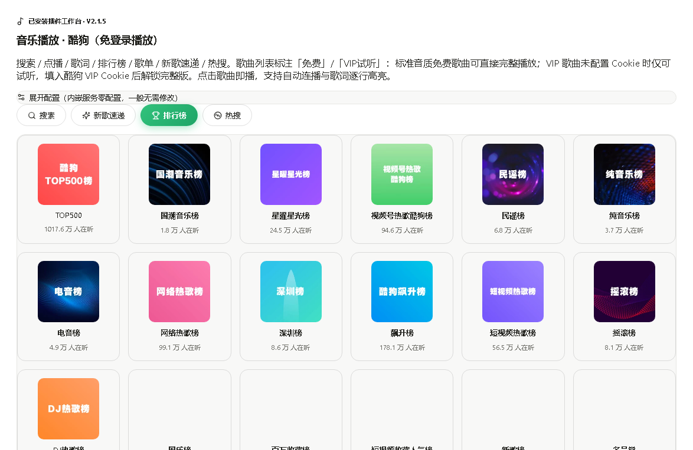
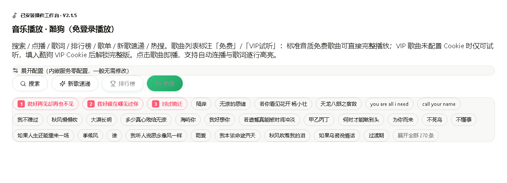

# 音乐播放器（酷狗曲库，走本机 MoeKoe 通道）

> 酷狗的播放接口有严格的设备风控——匿名请求几乎必然被 `20028 本次请求需要验证` 拦下，海外 IP 还会被直接区域封锁。这就是为什么大部分"酷狗第三方播放器"活不长。
>
> 若道音乐播放器不去硬闯风控，而是**借道本机 MoeKoe Music 客户端已完成设备注册的本地 API**（`127.0.0.1:6521`）：搜索、点播、歌词、榜单、歌单、新歌、热搜全部走这条通道，插件自身零依赖、零内嵌服务。没装 MoeKoe 也没关系——界面里点一下就能自动装好。

**📦 一键安装**：[https://ruodao.com/plugin-market/items/music-player](https://ruodao.com/plugin-market/items/music-player)（若道桌面端「功能插件市场」搜索"音乐"，或市场页直接「下载 ZIP」用本地安装导入。）

---

## 💎 四个理由

### 🎵 1. 酷狗全曲库，匿名也能完整播

搜索、点播、LRC 歌词、官方排行榜（TOP500 / 飙升榜 / 热歌榜）、歌单、新歌速递、实时热搜——一个都不少。标准音质（128k）通常可完整播放，不需要登录、不需要 Cookie。

### 🔌 2. 借道本地 API，绕开设备风控

MoeKoe 客户端启动时已完成设备注册与风控处理，插件只调用它暴露的本地接口。**插件本身不发任何伪造请求、不做任何会员绕过**，只是把客户端的合法能力接到你的工作台上。

### 📦 3. 一键装 MoeKoe，进度可见

没装 MoeKoe？点播被拦时界面会出现「一键安装 MoeKoe Music」按钮：自动从官方 release 下载安装包、静默安装、启动、完成设备注册，进度（下载百分比 / 安装 / 启动）实时显示。

### 🎚️ 4. 音质可调，VIP 歌也能处理

默认 320k，可切 128 / flac / hi。VIP 歌曲会按酷狗权限标注「免费」或「VIP试听」，配置 `RUODAO_KUGOU_COOKIE`（手机端 token）后 VIP 歌曲可完整播放——用的是你自己的会员权益。

## 🖼️ 界面预览

| 搜索 | 新歌速递 |
| --- | --- |
| [](docs/screenshots/1.png) | [](docs/screenshots/2.png) |

| 排行榜 | 热搜 |
| --- | --- |
| [](docs/screenshots/3.png) | [](docs/screenshots/4.png) |

## ✨ 功能总览

| 命令 | 输入（stdin JSON） | 输出 |
| --- | --- | --- |
| `doctor` 自检 | — | MoeKoe 安装 / 运行 / 设备注册状态 |
| `hot` 热搜榜 | — | 实时热搜关键词 |
| `search` 搜索 | `{ keywords, page?, pagesize? }` | 歌曲列表（曲名、歌手、hash、专辑、时长） |
| `play` 点播 | `{ keywords }` 或 `{ hash }` | 可直接播放的音频 URL |
| `lyric` 歌词 | `{ hash }` 或 `{ keywords }` | LRC 歌词文本 |
| `rank` 排行榜 | `{}` 或 `{ rankid, page?, pagesize? }` | 榜单列表 / 榜单内歌曲 |
| `playlist` 歌单 | `{ id, page?, pagesize? }` | 歌单详情与歌曲列表 |
| `top` 新歌速递 | `{ type? }` 1华语 2欧美 3韩国 4日本 | 新歌列表 |
| `moekoe_install` | — | 下载安装并启动 MoeKoe Music |
| `moekoe_status` | — | 安装 / 运行 / 设备注册状态 |

## 📥 安装

1. 下载并安装 [若道桌面端](https://ruodao.com)。
2. 「功能插件市场」→ 搜索 **音乐** → 安装。
3. 打开工作台，如果提示 MoeKoe 未就绪，点「一键安装 MoeKoe Music」（也可以自己去 [music.moekoe.cn](https://music.moekoe.cn/) 装）。

## ⚙️ 配置

| 变量 | 说明 | 默认 |
| --- | --- | --- |
| `RUODAO_MUSIC_API_BASE` | MoeKoe 本地 API 地址 | `http://127.0.0.1:6521` |
| `RUODAO_KUGOU_COOKIE` | 酷狗 VIP Cookie（`token=...;userid=...`），留空则 VIP 歌仅试听 | 空 |
| `RUODAO_MUSIC_QUALITY` | 默认音质：`128` / `320` / `flac` / `hi` | `320` |
| `RUODAO_MUSIC_PAGESIZE` | 搜索每页条数 | `20` |
| `MOEKOE_EXE` | MoeKoe 客户端 exe 路径（自动拉起用） | 自动探测 |

## 🚀 使用教程

- **听歌**：搜索 → 点歌 → 播放器直接放，歌词跟着走。
- **找新歌**：新歌速递按华语/欧美/韩国/日本分区；热搜榜点一下就能搜。
- **看榜单**：排行榜选 TOP500 / 飙升榜 / 热歌榜，榜单内可翻页。
- **提示"需要安全验证"**：在 MoeKoe 客户端里把这首歌播一次，完成验证后回来重试即可。

## 🛠️ 二次开发

```
├── plugin.json              # 元信息
├── ruodao-plugin.json       # 核心：id、权限（network/process）、11 个命令
├── ui.json                  # 工作台界面
├── bin/music.mjs            # 命令入口与业务逻辑
├── vendor/kugou-api.bundle.cjs  # KuGouMusicApi 客户端打包产物
├── vendor/kugou-server.cjs      # 本地服务启动器
├── test/plugin.test.mjs     # 测试
└── docs/screenshots/        # 本页截图
```

```bash
node bin/music.mjs moekoe_status
node bin/music.mjs search <<< '{"keywords":"海阔天空"}'
node bin/music.mjs play   <<< '{"keywords":"海阔天空"}'
node --test test/
```

改完直接在若道桌面端「插件管理 → 从本地安装」验证，或让若道 Agent 帮你改。

## 📦 更新日志

- **v2.1.5**（当前开源版本）：一键安装 MoeKoe 并查询进度、设备注册状态检测、榜单翻页、VIP 权限标注与音质切换。

## ⚖️ 说明

本项目不提供任何音乐内容，不做会员绕过。曲库与播放能力来自酷狗官方服务与你自己安装的 MoeKoe 客户端，请遵守相关服务条款，支持正版。

## 🔗 相关

- 插件市场页：[https://ruodao.com/plugin-market/items/music-player](https://ruodao.com/plugin-market/items/music-player)
- [MoeKoe Music](https://github.com/iAJue/MoeKoeMusic)（本地 API 来源）
- 若道官网：[https://ruodao.com](https://ruodao.com)
- 更多插件源码：[https://github.com/ruodaoai](https://github.com/ruodaoai)

## License

MIT
